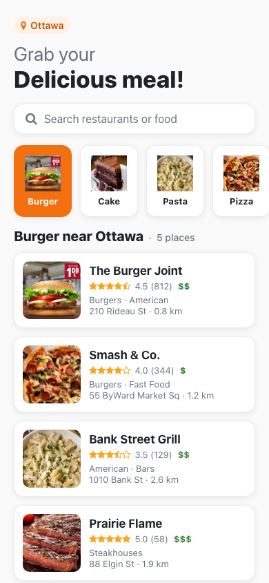
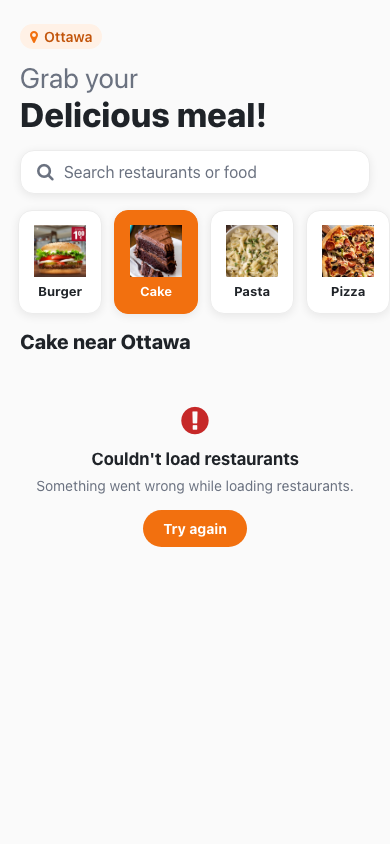
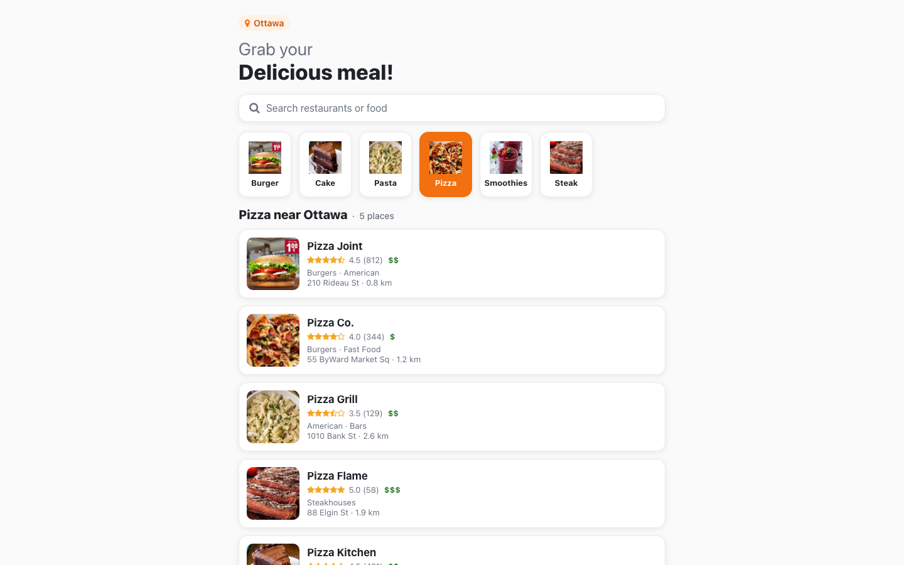

# Restaurant App (React Native)

An Expo / React Native app for finding restaurants by food category or search term, using the Yelp Fusion API.


<p>
  
  
</p>

## Overview

The app has a single, scrollable home screen: a header with the search location, a search box, a horizontal row of food categories (Burger, Cake, Pasta, Pizza, Smoothies, Steak) and a list of matching restaurants. Picking a category or submitting a search term queries Yelp's `/businesses/search` endpoint (15 results around `YELP_LOCATION`, default Ottawa) through a custom `useRestaurants` hook built on axios.

## Features

- Tap a food category or search for any restaurant or dish (press Enter / the search key to submit)
- Restaurant cards with photo, name, star rating, review count, price level, categories, address and distance; tap a card to open it on Yelp
- Loading indicator, an error state with **Try again**, and an empty state when nothing matches
- A clear message when no Yelp API key is configured
- Accessible labels and roles on the search box, categories and cards; layout capped at 720 px wide on tablets and the web
- App icon, adaptive icon, splash screen and favicon



## Tech stack

- React Native 0.71, Expo SDK 48 (with web support through `react-native-web` and `@expo/webpack-config`)
- axios, `expo-constants`
- `@expo/vector-icons` (FontAwesome)
- Yelp Fusion API

## Project structure

```
restaurant-app/
├── App.js                  # renders HomeScreen
├── app.json                # static Expo config (name, icons, splash)
├── app.config.js           # adds YELP_API_KEY / YELP_LOCATION to `extra`
├── assets/                 # app icon, adaptive icon, splash, favicon
├── docs/screenshots/
└── src/
    ├── api/yelp.js         # axios instance for the Yelp API
    ├── config.js           # reads the runtime config from expo-constants
    ├── hooks/useRestaurants.js
    ├── components/         # Header, Search, Categories, CategoryItem, RestaurantItem, ResultsState
    ├── common/styles.js    # colours and shadow
    ├── data/db.js          # category list and images
    ├── assets/images/      # category images
    └── screens/HomeScreen.js
```

## Getting started

### Prerequisites

- Node.js 16 or 18 and npm
- The Expo Go app (SDK 48) on a device, or an Android/iOS emulator
- A Yelp Fusion API key from https://www.yelp.com/developers

### Install

```bash
git clone https://github.com/VamsiKrishnaThota03/restaurant-app.git
cd restaurant-app
npm install
cp .env.example .env   # then set YELP_API_KEY
```

### Configure

| Variable        | Required | Description | Default |
| --------------- | -------- | ----------- | ------- |
| `YELP_API_KEY`  | yes | Yelp Fusion API key, read by `app.config.js` at start/build time | |
| `YELP_LOCATION` | no  | City or address to search around | `Ottawa` |

Values come from the environment or a local `.env` file (gitignored). Restart `npm start` after changing them.

### Run

| Command           | Description                                 |
| ----------------- | ------------------------------------------- |
| `npm start`       | Start the Expo dev server (`expo start`)    |
| `npm run android` | Open on an Android emulator or device       |
| `npm run ios`     | Open on the iOS simulator                   |
| `npm run web`     | Run in the browser (see limitations)        |

## Known limitations

- The Yelp key is still bundled into the app (any client-side key can be extracted). For a public release, call Yelp from a small backend proxy instead.
- In the browser, Yelp's API does not allow cross-origin requests, so `npm run web` shows the error state unless you put a proxy in front of it. The native apps are not affected.
- There is no restaurant details screen; tapping a card opens the Yelp page.
- Expo SDK 48 is old; upgrading to a current SDK (and React Native) was not done.
